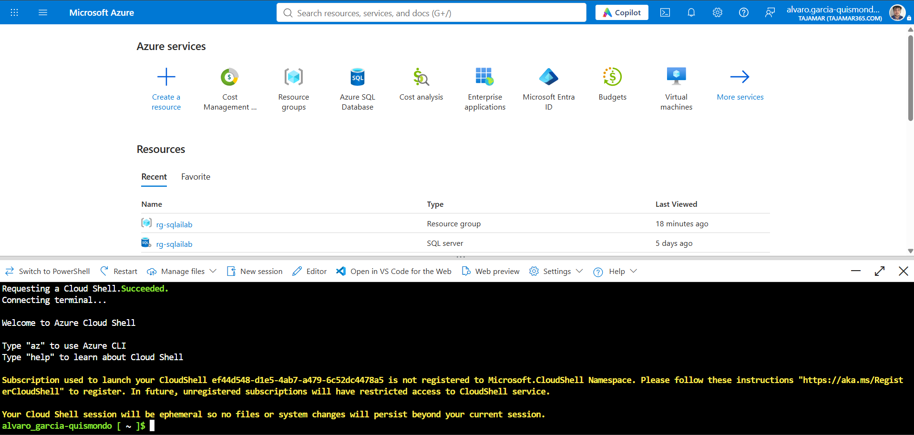
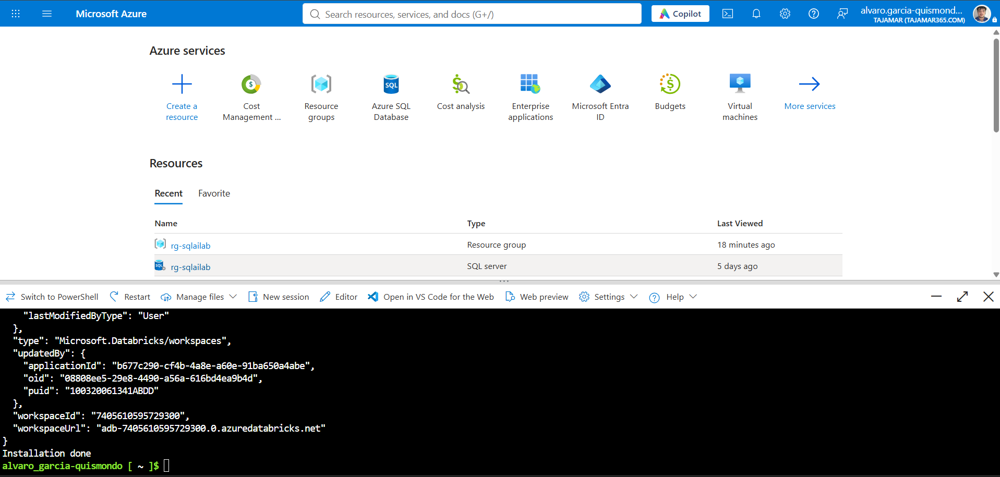
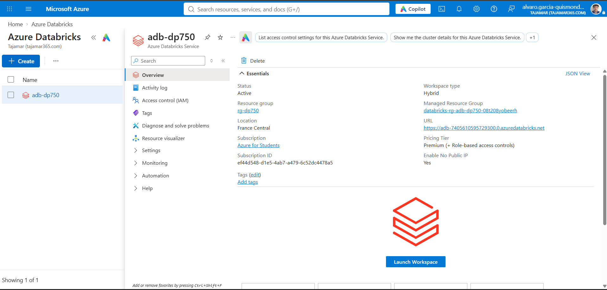
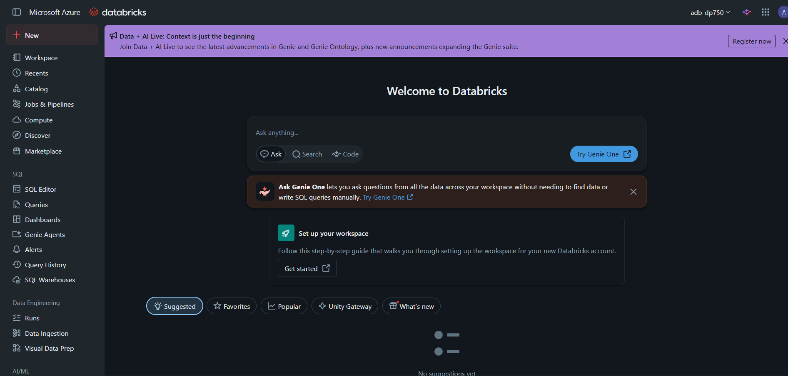

# Preparación del entorno Azure Databricks (DP-750)

Álvaro García-Quismondo Lizana
Curso DP-750: Implement Data Engineering Solutions using Azure Databricks
30 de octubre de 2026

## 1. Objetivo

Aprovisionar un workspace de Azure Databricks Premium desde Azure Cloud Shell, como paso previo a los laboratorios del curso. El laboratorio de preparación crea el grupo de recursos `rg-dp750` y el workspace `adb-dp750` con un único script de Azure CLI.

## 2. Entorno

| Elemento | Valor |
| --- | --- |
| Portal | https://portal.azure.com |
| Suscripción | Azure for Students (tenant Tajamar) |
| Shell | Azure Cloud Shell, Bash, sesión efímera |
| Script | `00-setup.sh` del repositorio MicrosoftLearning/DP-750T00 |
| Recursos | grupo `rg-dp750`, workspace `adb-dp750` |

## 3. Procedimiento

### 3.1 Apertura de Cloud Shell

Desde el portal abrí Cloud Shell con el botón `>_` de la barra superior y elegí Bash. Al arrancar aparece un aviso: la suscripción no está registrada en el espacio de nombres `Microsoft.CloudShell`. No impide usar la consola, y la sesión es efímera, así que lo que se descargue deja de existir al cerrarla.



*Figura 1. Cloud Shell abierto en el portal de Azure.*

### 3.2 Ejecución del script

Lancé el comando indicado en el laboratorio:

```bash
curl -sL https://raw.githubusercontent.com/MicrosoftLearning/DP-750T00-Implement-Data-Engineering-Solutions-using-Azure-Databricks/refs/heads/main/Instructions/Labs/00-setup.sh | bash
```

El script elige una región al azar de una lista fija. Mi ejecución cayó en `koreacentral` y el grupo de recursos se creó, pero el workspace falló.

Intento 1, región `koreacentral`:

```text
(RequestDisallowedByAzure) Resource 'adb-dp750' was disallowed by Azure: This policy
maintains a set of best available regions where your subscription can deploy resources.
Code: RequestDisallowedByAzure
Target: adb-dp750
```

La causa es una policy de la suscripción con el parámetro `listOfAllowedLocations`, que solo admite estas regiones: `spaincentral`, `polandcentral`, `denmarkeast`, `austriaeast` y `francecentral`.

El script acepta la región como primer argumento (`REGION=${1:-...}`), así que lo descargué a un fichero para poder indicarla. Antes hay que borrar el grupo de recursos, porque un grupo no puede cambiar de región.

```bash
az group delete --name rg-dp750 --yes
curl -sL https://raw.githubusercontent.com/MicrosoftLearning/DP-750T00-Implement-Data-Engineering-Solutions-using-Azure-Databricks/refs/heads/main/Instructions/Labs/00-setup.sh -o 00-setup.sh
bash 00-setup.sh spaincentral
```

Intento 2, región `spaincentral`. Está permitida por la policy, pero Azure Databricks no se ofrece allí:

```text
(LocationNotAvailableForResourceType) The provided location 'spaincentral' is not
available for resource type 'Microsoft.Databricks/workspaces'.
Code: LocationNotAvailableForResourceType
```

La región que aparece a la vez en la lista de la policy y en la de regiones de Azure Databricks es `francecentral`.

```bash
az group delete --name rg-dp750 --yes
bash 00-setup.sh francecentral
```

Intento 3, región `francecentral`: el script terminó con `Installation done`.



*Figura 2. Salida final del script con `Installation done`.*

### 3.3 Verificación en el portal

En el portal, Azure Databricks muestra el workspace `adb-dp750` con estado Active, región France Central y nivel Premium (+ Role-based access controls).



*Figura 3. Resumen del workspace `adb-dp750`.*

### 3.4 Apertura del workspace

Con Launch Workspace se abre la interfaz de Azure Databricks en una pestaña nueva. Se ve la página de inicio, con el workspace `adb-dp750` seleccionado arriba a la derecha.



*Figura 4. Página de inicio de Azure Databricks.*

## 4. Resultado

| Propiedad | Valor |
| --- | --- |
| Workspace | `adb-dp750` |
| Grupo de recursos | `rg-dp750` |
| Región | France Central |
| Nivel | Premium (+ Role-based access controls) |
| Estado | Active |
| Tipo de workspace | Hybrid |
| Enable No Public IP | Yes |
| Grupo gestionado | `databricks-rg-adb-dp750-08t208yobeerh` |
| URL | https://adb-7405610595729300.0.azuredatabricks.net |

## 5. Limpieza

Al terminar el curso hay que eliminar `rg-dp750` para que no consuma crédito de la suscripción. Al borrar el grupo desaparece también el workspace y su grupo gestionado:

```bash
az group delete --name rg-dp750 --yes --no-wait
```

## Contenido del paquete

```text
README.md
DP750_Setup_Databricks.pdf
img/       capturas numeradas
scripts/   00-setup.sh (original, sin modificar)
           01-comandos-resolucion.sh (comandos usados, en orden)
```
